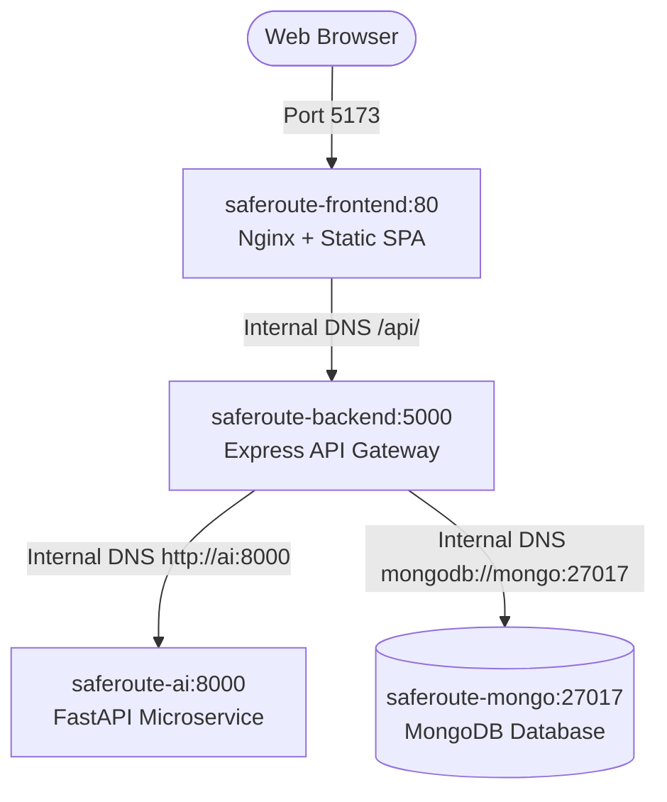

# SafeRoute 🛡️
> **Smarter Journeys. Safer Choices.**

SafeRoute is a modern, safety-conscious navigation platform that evaluates travel routes using multi-dimensional safety parameters (lighting quality, crime risks, accident histories, and crowd levels) coupled with enterprise-grade authentication.

---

## ✨ Features

- **🛡️ Admin Command Center Dashboard**:
  - Live system telemetry: Server Uptime, Memory usage (MB), API Latency (ms), and active security policies.
  - User Management Directory: View all registered accounts, promote/demote administrator privileges with 1 click, and delete accounts.
  - Microservices Health: Real-time health monitoring of AI FastAPI (Port 8000), Express API Gateway (Port 5000), Dual-Layer Database, and Mail Gateway.
  - Interactive AI Model Simulator: Tune lighting, crime index, accident risk, and crowd density sliders with live AI score inference.
  - Direct URL access via `/admin` and `#admin`.
- **🗺️ Interactive Route Safety Evaluator**:
  - Route priority presets: 🌙 Well-Lit Night Walk, ⚡ Direct Commute, 🛡️ Maximum Caution, 🎛️ Custom Tuners.
  - Multi-variable risk assessment across illumination, crime, accidents, and crowds.
  - Visual metrics breakdown meters and context-aware Route Safety Advisories.
- **🔐 End-to-End Authentication**:
  - Administrator credentials are provisioned from backend environment variables; the dedicated admin sign-in page has no registration option.
  - Secure Registration & Login with `bcryptjs` password hashing.
  - 6-Digit Cryptographic Numeric OTP for email verification and password recovery.
  - Dual-token architecture with in-memory Access Tokens & `httpOnly` Refresh Token Rotation (RTR).
  - Rate limiting, brute-force mitigation, and zero-enumeration password resets.
  - Live interactive password strength evaluator.
- **🤖 AI Route Safety Scoring & Routing Architecture**:
  - Real-time scoring microservice built with FastAPI at `http://127.0.0.1:8000` executing a 60-tree Random Forest Regressor ensemble.
  - Multi-factor safety evaluation: Streetlighting quality (0-10), Crime severity index (0-10), Accident risk probability (0-10), Crowd pedestrian density (0-10), Time of Day, and Emergency services proximity.
  - Prioritizes personal safety over raw transit distance: recommends verified, illuminated corridors with active foot traffic over isolated, unmonitored shortcuts.
  - Routing Provider Abstraction: Pluggable provider support (OpenRouteService, OSRM) via backend `.env` keys. Falls back to an explicit demonstration sandbox with non-navigable disclaimers when unconfigured.
  - Resilient Fallback Engine: If the Python AI service is unreachable, the Node.js backend seamlessly executes an onboard heuristic formula to ensure 100% service uptime.
  - Safety Policy Notice: Explicitly discloses that no route can be guaranteed 100% safe.
- **⚡ Modern Responsive UI**:
  - React 19 + TypeScript + Vite.
  - GSAP-powered interactive DotGrid background canvas.
  - Glassmorphic modal overlays, custom toast alerts, and responsive layouts.
- **☁️ Multi-Service Cloud Architecture**:
  - Pre-configured for seamless Vercel deployment with automated microservice rewrites.
- **📸 Exported Visual Previews**:
  - Complete application flow and admin dashboard screenshots archived in `screenshots/`.

---

## 🏗️ Repository Architecture

```
SafeRoute/
├── ai/          # Python FastAPI Safety Prediction Microservice
├── backend/     # Express 5 + TypeScript + MongoDB Authentication & Gateway
├── frontend/    # React 19 + TypeScript + Vite Single-Page Application
├── docs/        # Comprehensive Project & API Documentation
└── vercel.json  # Multi-Service Cloud Deployment Specification
```

---

## 📚 Documentation Links

- 📖 [Project Overview](docs/PROJECT_OVERVIEW.md) - High-level pillars and technical architecture.
- 🗄️ [Database Architecture & Design](docs/database-design.md) - Full schemas, ERD, indexes, ownership, and security.
- 🗺️ [10-12 Day MVP Roadmap](docs/MVP.md) - Day-by-day Minimum Viable Product delivery schedule.
- 🗂️ [Project Structure](docs/PROJECT_STRUCTURE.md) - Detailed directory layout and component breakdown.
- 🔌 [API Documentation](docs/API_DOCUMENTATION.md) - Full specification of all Auth, Route, and Safety endpoints.
- 🚀 [Setup & Run Guide](docs/SETUP_GUIDE.md) - Step-by-step local development setup and Vercel instructions.

---

## 🗄️ Database Architecture & Setup

SafeRoute utilizes **MongoDB** via **Mongoose** (`^9.11.1`) with a resilient dual-layer architecture. In development/testing, an in-memory fallback layer allows the application to run smoothly even before MongoDB is started, while logging explicit setup steps.

### Data Models & Collections

1. **`User` (`users`)**: Commuter and administrator profiles. Normalizes emails to lowercase, hashes passwords with bcrypt (salt 12), enforces unique email constraints (code 11000), restricts roles to `user` or `admin`, and excludes password hashes from API responses (`select: false`, `.toJSON()` stripping).
2. **`SafetyPrediction` (`safetypredictions`)**: Stores multi-factor AI evaluations (lighting, crime, accident, crowd) and 0–100 safety scores. Supports authenticated user references and client idempotency keys (`clientRequestId`) to avoid duplicate records on retries.
3. **`RouteHistory` (`routehistories`)**: Persists selected or navigated routes **only when valid route data is present**. Enforces strict user ownership restrictions (users can only access/delete their own routes).
4. **`AuditLog` (`auditlogs`)**: Records administrative actions (role updates, deletions, maintenance). Automatically redacts all passwords, tokens, and secrets via recursive sanitization before persistence.
5. **`Otp` (`otps`)**: 6-digit cryptographic verification codes with automated MongoDB TTL index expiration.
6. **`RefreshToken` (`refreshtokens`)**: Manages Refresh Token Rotation (RTR) families with TTL auto-cleanup.

### Setup Instructions

#### Option 1: Docker (Fastest full-stack containerized setup)
```bash
docker compose up -d mongo
# Or launch all microservices together:
docker compose up -d
```

#### Option 2: Local MongoDB Service
```powershell
# Windows PowerShell (as Administrator):
net start MongoDB
```

#### Option 3: MongoDB Atlas (Free Cloud Database)
1. Create a cluster on [MongoDB Atlas](https://www.mongodb.com/atlas).
2. In `backend/.env`, set:
   ```env
   MONGO_URI=mongodb+srv://<username>:<password>@<cluster>.mongodb.net/saferoute?retryWrites=true&w=majority
   ```

### Database Initialization & Index Synchronization
Synchronize collection indexes, schema constraints, and verify administrator accounts:
```bash
cd backend
npm run db:init
```

### Health Check Probes
- `GET /api/health` — Full system status including database connection state, engine, host, and roundtrip ping latency.
- `GET /api/health/db` — Dedicated database health check returning HTTP 200 (connected) or HTTP 503 (offline with troubleshooting guide).

---

---

## ⚡ Quick Start

### 1. Backend
```powershell
cd backend
npm install
Copy-Item .env.example .env
npm run dev
```

### 2. Frontend
```powershell
cd frontend
npm install
npm run dev
```

### 3. AI Service (Optional)
```powershell
cd ai
python -m venv .venv
.\.venv\Scripts\Activate.ps1
pip install -r requirements.txt
uvicorn app.main:app --reload --port 8000
```

---

## 🛡️ Administrator Access

Set `ADMIN_EMAIL` and `ADMIN_PASSWORD` in `backend/.env` before starting the backend. The backend seeds or synchronizes that administrator account from those values; it does not use built-in credentials. Choose a unique strong password and keep the `.env` file private.

Open `http://localhost:5173/#/admin-login` to sign in as an administrator. This page offers sign-in and password recovery only; account registration is not available there. After signing in, the console is at `http://localhost:5173/#/admin`.

---

## 📸 Screenshots Gallery

High-resolution visual captures are stored in the [`screenshots/`](screenshots/) directory:
- `admin_dashboard_1791621746794.png`: Full Admin Command Center Dashboard
- `admin_dropdown_menu_1791621673939.png`: User menu with Admin badge and Console link
- `route_safety_evaluation_result_1791623499874.png`: Interactive AI Route Evaluation Result
- `verification_successful_page_1791619144737.png`: 6-digit OTP email verification
- `register_modal_view_1791618662328.png`: Account registration with live password validator

---

## 📱 Responsive Testing & Multi-Viewport Verification

SafeRoute has been tested and verified across standard mobile, tablet, and desktop viewports using automated headless browser testing and subagents:

| Viewport Category | Resolution (W x H) | Status | Key Features Verified |
| :--- | :--- | :--- | :--- |
| **Mobile (Compact)** | `375px × 667px` | ✅ **PASS** | `scrollWidth === innerWidth` (zero horizontal overflow); touch targets $\ge 42\text{px}$; 1-column input fields; stacked route cards |
| **Mobile (Modern)** | `390px × 844px` | ✅ **PASS** | Dynamic OTP box sizing; modal overlays fit within viewport; responsive hero title scaling; stacked action buttons |
| **Tablet** | `768px × 1024px` | ✅ **PASS** | Auto-collapsing sidebar to sliding drawer; flexible route factor grid; adaptive map container height |
| **Desktop / Wide** | `1280px × 800px+` | ✅ **PASS** | Persistent sticky sidebar; side-by-side interactive map and factor controls; multi-column admin telemetry |

### Responsive Design Fixes Applied:
- **Root Fluidity**: Replaced fixed `#root` width (`1126px`) with 100% fluid width, global `box-sizing: border-box`, and viewport overflow clamping (`overflow-x: hidden`).
- **Form Controls**: Dynamic grid templates (`grid-template-columns: 1fr` on screens $< 640\text{px}$) to prevent input clipping.
- **Touch Accessibility**: Ensured all buttons, selector chips, and modal inputs have min-height $\ge 40\text{px}$ with adequate tap padding.
- **Scrollable Data Tables**: Added `-webkit-overflow-scrolling: touch` horizontal scroll wrappers on admin and user history tables.

---

## 🧪 Automated Test Suites & Verification

SafeRoute includes automated unit, integration, schema, and end-to-end regression tests across all three tiers:

### 1. Backend Test Suites (Node.js & Express)
- **Command**: `npm test` (inside `backend/`)
- **Results**: **70 tests passing across 14 test suites** (0 failures, 0 skipped)
- **Coverage**:
  - `auth.test.ts`: Cryptographic hashing, OTP lifecycle, JWT generation, Refresh Token Rotation (RTR), and replay detection.
  - `admin.test.ts`: Role-Based Access Control (RBAC), user promotion/demotion, administrator telemetry, and secret scrubbing.
  - `database.test.ts`: Mongoose schema validation, unique indexes, route history ownership, and audit log scrubbing.
  - `api.test.ts`: Health endpoints, route prediction, input validation, and centralized 404/500 error handlers.
  - `e2e.test.ts`: Complete user registration $\to$ OTP verification $\to$ login $\to$ token refresh $\to$ password reset $\to$ logout cycle.

### 2. Frontend Test Suites (React & TypeScript)
- **Command**: `npm test` (inside `frontend/`)
- **Build Verification**: `npm run build` (runs `tsc -b && vite build`)
- **Results**: **6 tests passing** + **clean production bundle build** (0 type errors)
- **Coverage**:
  - Score classification logic (Optimal Safe, Moderate Caution, High Risk).
  - Safety factor bounds checking ($0 \le \text{factor} \le 10$).
  - Route alternative ranking and recommendation selection.
  - Form validation rules (email regex, password complexity).
  - Responsive breakpoint matrix integrity.

### 3. AI Service Test Suites (Python & FastAPI)
- **Command**: `python tests/test_ai_service.py -v` (inside `ai/`)
- **Results**: **11 tests passing** (0 failures)
- **Coverage**:
  - Health check probe (`/health`) and feature metadata.
  - Random Forest Regressor 60-tree ensemble scoring logic.
  - Boundary value handling (all 0s, all 10s).
  - Monotonic safety relationship (safe routes strictly outscore hazardous corridors).
  - Pydantic schema validation ($422\text{ Unprocessable Entity}$ on out-of-range inputs or missing fields).

---

## 🐳 Docker Multi-Container Orchestration

SafeRoute is fully containerized using Docker and Docker Compose with dedicated service networking, automated health checks, and startup order orchestration.

### Container Architecture & Internal Networking



> [!IMPORTANT]
> Containers communicate through the internal `saferoute-net` bridge network using service names (`mongo`, `ai`, `backend`). Cross-container requests **never use `localhost`**.

### Docker Commands

```bash
# Build and start all 4 services in detached mode
docker compose up --build -d

# Check real-time service health and container status
docker compose ps

# View live aggregate logs
docker compose logs -f

# Stop and tear down all containers
docker compose down
```

## 🌐 Vercel Production Deployment & Real Email Configuration

SafeRoute is architected for deployment on Vercel. Follow these configuration guidelines:

### 1. Environment Variables Configuration

In **Vercel Project Settings → Environment Variables**, add the following keys:

#### Backend Serverless Project:
| Environment Variable | Description | Example / Recommended Value |
|----------------------|-------------|-----------------------------|
| `NODE_ENV` | Environment mode | `production` |
| `MONGO_URI` | Persistent MongoDB cluster URI (Atlas) | `mongodb+srv://<user>:<pass>@cluster0.mongodb.net/saferoute?retryWrites=true&w=majority` |
| `RESEND_API_KEY` | Resend API key for real email delivery | `re_123456789abcdef` (Get from [resend.com](https://resend.com)) |
| `EMAIL_FROM` | Verified sender address | `SafeRoute Security <onboarding@resend.dev>` or your domain |
| `JWT_ACCESS_SECRET` | Cryptographically random secret (min 32 chars) | `openssl rand -hex 32` |
| `JWT_REFRESH_SECRET` | Cryptographically random secret (min 32 chars) | `openssl rand -hex 32` |
| `FRONTEND_URL` | Production frontend domain for CORS | `https://saferoute-frontend.vercel.app` |
| `ADMIN_EMAIL` | Administrator email used by the backend seeder | `admin@example.com` (replace this) |
| `ADMIN_PASSWORD` | Unique strong administrator password used by the backend seeder | Set privately in `backend/.env` |

*(Optional SMTP alternative: set `SMTP_HOST`, `SMTP_PORT`, `SMTP_USER`, `SMTP_PASS`, `SMTP_FROM` instead of Resend).*

#### Frontend Project:
| Environment Variable | Description | Example / Recommended Value |
|----------------------|-------------|-----------------------------|
| `VITE_API_BASE_URL` | Deployed backend API gateway base URL | `https://saferoute-backend.vercel.app/api` |

---

## 🚀 GitHub Actions Continuous Integration (CI)

SafeRoute utilizes GitHub Actions (`.github/workflows/ci.yml`) to enforce automated code quality and test passes on every push and pull request:

1. **`backend-test`**: Node.js 20 setup, dependency installation, TypeScript build, and full 70-test suite execution.
2. **`frontend-check`**: Node.js 20 setup, Linux binary dependencies, frontend test suite, and Vite production bundle compilation.
3. **`ai-service`**: Python 3.12 setup, dependency installation, bytecode compilation, and FastAPI test execution.
4. **`full-stack-integration`**: Spawns a live MongoDB service container, boots the AI microservice in background, and executes end-to-end integration tests with live service networking.

---

## 🔧 Troubleshooting & FAQ

### 1. MongoDB Connection Warning
- **Symptom**: `[DATABASE WARNING] MongoDB is currently unavailable or offline.`
- **Explanation**: In local development, SafeRoute activates an **in-memory resilient development layer** so developers can inspect and test the UI without having MongoDB installed locally.
- **Fix for Persistent Storage**: Start MongoDB locally via `net start MongoDB`, run `docker compose up -d mongo`, or supply a MongoDB Atlas connection string in `backend/.env`.

### 2. PowerShell Script Execution Policy Error on Windows
- **Symptom**: `npm : File ... cannot be loaded because running scripts is disabled on this system.`
- **Fix**: Use `npm.cmd` instead of `npm` (e.g., `npm.cmd test`, `npm.cmd run dev`).

### 3. Ports Already in Use
- Port 5000 (Backend), Port 5173 (Frontend), Port 8000 (AI), Port 27017 (MongoDB).
- Identify and terminate conflicting processes:
  ```powershell
  Get-NetTCPConnection -LocalPort 5000, 5173, 8000, 27017 | Format-Table
  ```

---

## 🔒 Security Best Practices Implemented

1. **XSS Protection**: Access token kept in memory; refresh token stored strictly in `httpOnly` cookies.
2. **CSRF Protection**: `SameSite=Lax` / `SameSite=Strict` cookie policies.
3. **Replay & Compromise Detection**: Refresh Token Rotation revokes the entire family if an already-revoked token is replayed.
4. **Brute Force Protection**: Endpoint rate limiting via `express-rate-limit` (15/15m on auth, 6/15m on OTPs).
5. **Anti-Enumeration**: Consistent generic messaging on password reset prevents user account discovery.
6. **HTTP Hardening**: Security headers injected via `helmet()`.

---

## 📄 License
ISC License © 2026 SafeRoute

