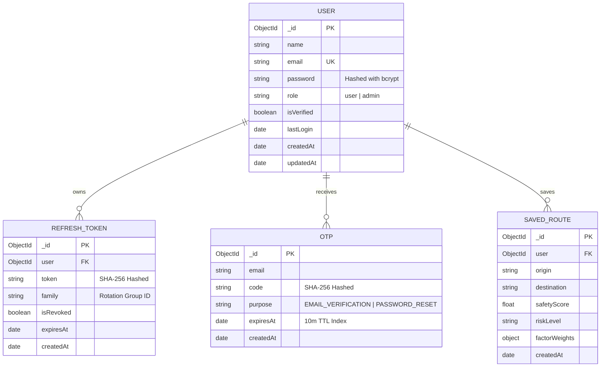

# 🏗️ SafeRoute System Architecture & Engineering Blueprint

> **Document Version**: 1.0.0  
> **Status**: Comprehensive Technical Specification  
> **Target Audience**: System Architects, Senior Developers, and Evaluators  

---

## 1. High-Level System Architecture

SafeRoute is structured as a resilient, multi-tiered microservice architecture. The system decouples the frontend client, the Node.js API Gateway, the Python AI Machine Learning engine, and the persistent storage tier.

```mermaid
graph TD
    subgraph Client Tier ["Client Tier (Browser)"]
        UI["React 19 + TypeScript + Vite"]
        Store["AuthContext (JWT in Memory)"]
        UI <--> Store
    end

    subgraph Gateway Tier ["API Gateway (Port 5000)"]
        Express["Express 5 Server"]
        Security["Security Middlewares (Helmet, CORS, CookieParser)"]
        Limiter["Rate Limiting (express-rate-limit)"]
        AuthMiddleware["JWT Authentication Guard & RBAC"]
        Validators["Zod Schema Validation Layer"]
        Controllers["Controllers (Auth, Admin, Safety)"]
        Proxy["Mongoose Proxy Fallback Engine"]

        Express --> Security
        Security --> Limiter
        Limiter --> Validators
        Validators --> AuthMiddleware
        AuthMiddleware --> Controllers
        Controllers --> Proxy
    end

    subgraph Intelligence Tier ["AI Microservice (Port 8000)"]
        FastAPI["Python FastAPI Server (Uvicorn)"]
        RFModel["Random Forest Regressor (Scikit-Learn)"]
        FallbackModel["Mathematical Ensemble Tree Baseline"]

        FastAPI --> RFModel
        RFModel -.->|Cold Start Fallback| FallbackModel
    end

    subgraph Data Tier ["Persistence Tier"]
        MongoDB[("MongoDB Database")]
        MemoryStore[("In-Memory Mock Store (memoryStore.ts)")]
        
        Proxy -->|ReadyState === 1| MongoDB
        Proxy -->|ReadyState !== 1| MemoryStore
    end

    UI -->|HTTP / JSON & Cookies| Express
    Controllers -->|Internal HTTP Proxy (Axios)| FastAPI
```

---

## 2. Frontend Architecture (`frontend/`)

### 2.1 Technology Stack
- **Framework**: React 19 (`react: ^19.2.8`, `react-dom: ^19.2.8`)
- **Language**: TypeScript (`~6.0.2`)
- **Build Tool**: Vite 8 (`vite: ^8.3.4`)
- **Styling**: Vanilla CSS with modern custom design tokens, glassmorphism, responsive grid & flexbox systems.
- **Icons**: Lucide React (`lucide-react: ^1.55.0`)
- **Animation**: GSAP (`gsap: ^3.15.0`) for interactive canvas dot-matrix background.

### 2.2 Component Hierarchy & Routing
The frontend employs a unified, URL-hash-synchronized state machine (`AppRoute: 'login' | 'landing' | 'app' | 'admin'`):

```
App.tsx (Route Controller & RBAC Guard)
├── Toast Notifications (Global toast messaging)
├── Screen 1: LoginPage.tsx (Default unauthenticated entry)
│   ├── Left Column: Brand Showcase, AI Metrics, Feature Highlights
│   └── Right Column: Auth Card (LoginForm | RegisterForm | OtpForm | ResetPasswordForm)
├── Screen 2: LandingPage.tsx (Public Overview)
│   ├── Sticky Navbar (Brand, Anchor Links, Sign In / Register buttons)
│   ├── Hero Section with Interactive DotGrid canvas
│   ├── 4-Factor Risk Evaluation Metrics
│   ├── 6-Feature Intelligent Protection Grid
│   ├── 4-Step Interactive Workflow
│   └── Mission & Architecture Foundation
├── Screen 3: UserDashboard.tsx (Traveler Route Safety Planner)
│   ├── Header: Brand, Navigation, Traveler Profile Dropdown
│   ├── Route Evaluation Form: Source and Destination inputs
│   ├── Safety Profile Tuner: Presets (Night, Commute, Max Crowd, Custom)
│   ├── Interactive Factor Sliders: Lighting, Crime, Accident, Crowd
│   ├── AI Safety Score Display: 0–100 score, Risk Level, Factor meters
│   └── Travel Safety Advisories & Safe Zone recommendations
└── Screen 4: AdminDashboard.tsx (Admin Command Center)
    ├── Header: Admin meta, System Uptime, Route Planner toggle, Logout
    ├── Tabs: Overview & Telemetry | Microservices | User Management | AI Model Probe
    ├── Telemetry Grid: AI Status, API Gateway Memory, Registered Users, Security
    ├── User Management Table: User listing, Promote, Demote, Delete actions
    └── Interactive AI Tester: Live inference parameter adjustment with latency readout
```

---

## 3. Backend Architecture (`backend/`)

### 3.1 Technology Stack
- **Runtime**: Node.js (v20+) with TypeScript (`tsx`, `typescript: ~6.0.2`)
- **Web Framework**: Express 5 (`express: ^5.2.1`)
- **Security & Headers**: Helmet (`helmet: ^8.3.0`), CORS with credentials (`cors: ^2.8.6`)
- **Validation**: Zod schema validation (`zod: ^4.6.5`)
- **Authentication**: JSON Web Tokens (`jsonwebtoken: ^9.0.3`) & Bcrypt (`bcryptjs: ^3.0.3`)
- **Database Driver**: Mongoose (`mongoose: ^9.11.1`)
- **Mailing**: Nodemailer (`nodemailer: ^10.0.16`) with Ethereal development inbox preview

### 3.2 Security Pipeline
Every incoming request traverses this sequence:
1. **Helmet:** Injects security headers (X-Content-Type-Options, X-Frame-Options, Strict-Transport-Security).
2. **CORS:** Restricts cross-origin requests to configured origins with `credentials: true`.
3. **Cookie Parser:** Parses signed and standard cookies (`refreshToken`).
4. **Body Parser:** Parses JSON payloads up to 1MB.
5. **Rate Limiting:** Protects sensitive endpoints against brute-force attacks.
6. **Zod Validator (`validate(schema)`):** Validates body, query, and params against typed schemas.
7. **Auth Middleware (`requireAuth` / `requireAdmin`):** Extracts Bearer JWT, validates signature and expiration, attaches `req.user`, and verifies role permissions.

---

## 4. Database Architecture & Entity Specifications

The database layer utilizes a **hybrid proxy pattern**: if MongoDB is running (`readyState === 1`), Mongoose persists directly to database collections; if MongoDB is unavailable during local development or unit tests, operations transparently route to `memoryStore.ts`.

### 4.1 Entity Relationship Diagram (ERD)



---

## 5. AI Service Architecture (`ai/`)

### 5.1 Architecture & Pipeline
- **Runtime**: Python 3.10+
- **Framework**: FastAPI with Uvicorn ASGI server on port 8000
- **Model Engine**:
  1. Primary: Scikit-Learn `RandomForestRegressor` (`safety_model.joblib`)
  2. Standalone Fallback: JSON Decision Tree Ensemble (`safety_model.json`)
  3. Edge Baseline: Mathematical weighted regression formula:
     $$\text{Score} = (\text{Lighting} \times 3.4) + (\text{Crowd} \times 2.3) + ((10 - \text{Crime}) \times 2.6) + ((10 - \text{Accident}) \times 1.7)$$

### 5.2 Input Parameters
- `lighting`: float (0.0 to 10.0) — Illumination quality of the corridor
- `crime_risk`: float (0.0 to 10.0) — Historical crime density index
- `accident_risk`: float (0.0 to 10.0) — Traffic collision frequency
- `crowd_level`: float (0.0 to 10.0) — Active pedestrian density

---

## 6. API Endpoints Catalog

### 6.1 Authentication API (`/api/auth`)
| Method | Endpoint | Auth | Description |
| :--- | :--- | :--- | :--- |
| `POST` | `/api/auth/register` | Public | Registers a new account, hashes password, sends 6-digit OTP |
| `POST` | `/api/auth/verify-otp` | Public | Validates 6-digit OTP, verifies account, returns access token |
| `POST` | `/api/auth/resend-otp` | Public | Generates and sends a new OTP (60s cooldown enforced) |
| `POST` | `/api/auth/login` | Public | Authenticates credentials; returns Access Token and HttpOnly Refresh Cookie |
| `POST` | `/api/auth/refresh-token` | Public (Cookie) | Rotates Refresh Token (RTR) and issues fresh Access Token |
| `GET` | `/api/auth/me` | Bearer JWT | Retrieves current user profile details |
| `POST` | `/api/auth/forgot-password` | Public | Generates password reset OTP and dispatches email |
| `POST` | `/api/auth/reset-password` | Public | Consumes verified OTP and updates password |
| `POST` | `/api/auth/logout` | Bearer JWT | Invalidates active refresh token and clears cookie |

### 6.2 Admin API (`/api/admin`)
| Method | Endpoint | Auth | Description |
| :--- | :--- | :--- | :--- |
| `GET` | `/api/admin/stats` | Admin JWT | Retrieves system telemetry (memory, uptime, microservice status, user list) |
| `PATCH` | `/api/admin/users/:id/role` | Admin JWT | Promotes or demotes user role (`'user'` $\leftrightarrow$ `'admin'`) |
| `DELETE` | `/api/admin/users/:id` | Admin JWT | Deletes user account and associated active sessions |

### 6.3 Safety & Routing API (`/api/safety`)
| Method | Endpoint | Auth | Description |
| :--- | :--- | :--- | :--- |
| `POST` | `/api/safety/predict` | Optional | Evaluates route parameters via AI microservice and returns safety score & breakdown |
| `GET` | `/api/health` | Public | Gateway health check and operational status |
