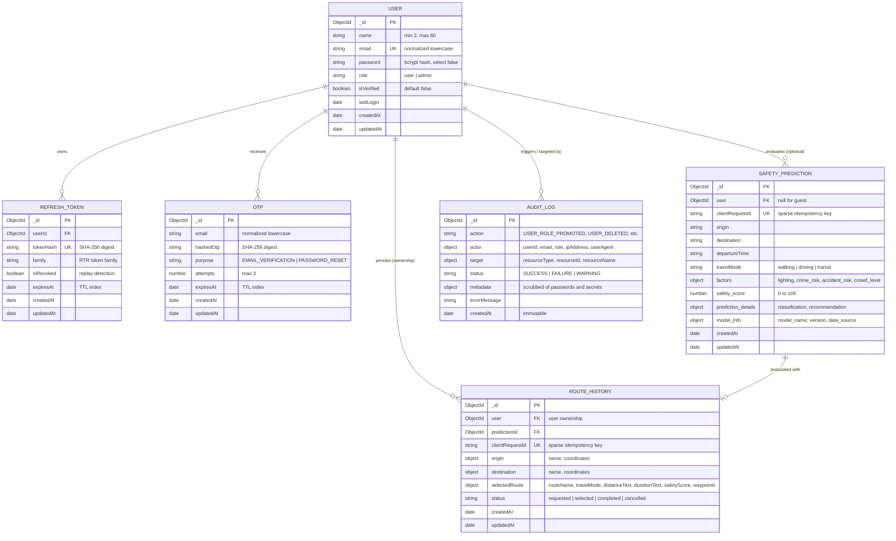

# SafeRoute — Database Architecture & Design Specification

This document details the database layer design, collections, entity relationships, validation rules, indexing strategy, data security safeguards, and operations for the **SafeRoute — AI-Powered Safety-Aware Route Recommendation System**.

---

## 1. System Overview & Technology Stack

- **Database Engine**: MongoDB (Document Store) via Mongoose ODM (`^9.11.1`).
- **Resilience Strategy**: Dual-mode execution with real-time health probing. When MongoDB is available, full persistent document storage with compound indexes is active. If MongoDB is offline during local development or unit testing, an in-memory fallback layer ensures zero developer disruption while logging required setup steps.
- **Security & Privacy**:
  - Passwords hashed using bcrypt with salt factor 12.
  - Password hashes excluded by default from query results and API serializations (`select: false`, `.toJSON()` stripping).
  - Sensitive authentication credentials (passwords, tokens, OTPs) strictly redacted from `AuditLog`.
  - Idempotent deduplication keys (`clientRequestId`) preventing duplicate prediction and route records caused by network retries.

---

## 2. Entity Relationship Diagram (ERD)



---

## 3. Detailed Model Schemas & Specifications

### 3.1. `User` Collection (`users`)

Manages commuter and administrator credentials, verification state, and role-based clearance.

| Field | Type | Constraints & Rules | Description |
|---|---|---|---|
| `_id` | `ObjectId` | Primary Key, Auto-generated | Unique record identifier |
| `name` | `String` | Required, Trimmed, Length: 2–60 chars | User's display name |
| `email` | `String` | Required, Unique, Lowercase, Trimmed, Regex validated | Normalized email address |
| `password` | `String` | Required, `select: false`, bcrypt salt 12 | Password hash (never plain text) |
| `role` | `String` | Required, Enum: `['user', 'admin']`, Default: `'user'` | Role-based access level |
| `isVerified` | `Boolean` | Default: `false`, Indexed | Email OTP verification status |
| `lastLogin` | `Date` | Optional | Timestamp of most recent authentication |
| `createdAt` | `Date` | Auto-generated (`timestamps: true`) | Account creation timestamp |
| `updatedAt` | `Date` | Auto-generated (`timestamps: true`) | Last modification timestamp |

#### Security & Exclusion Safeguards
- **Schema Pre-Save Hook**: If `password` is modified, automatically generates a 12-round bcrypt salt and hashes the password before persistence.
- **Serialization Redaction**: Both `toJSON` and `toObject` transforms explicitly delete `ret.password` and `ret.__v`.
- **Unique Email Constraint**: Enforces unique normalized email indexing (`email_1`). Duplicate registrations throw error code `11000`.

---

### 3.2. `SafetyPrediction` Collection (`safetypredictions`)

Stores multi-dimensional AI inference evaluations performed by the SafeRoute Machine Learning service.

| Field | Type | Constraints & Rules | Description |
|---|---|---|---|
| `_id` | `ObjectId` | Primary Key, Auto-generated | Prediction record identifier |
| `user` | `ObjectId` | Optional (`ref: 'User'`), Indexed | Associated traveler (or `null` if guest) |
| `clientRequestId` | `String` | Sparse, Unique, Trimmed | Client idempotency key for retry safety |
| `origin` | `String` | Optional, Trimmed, Max: 200 chars | Journey starting location |
| `destination` | `String` | Optional, Trimmed, Max: 200 chars | Journey destination location |
| `departureTime` | `String` | Default: `'Immediate'` | Planned departure window |
| `travelMode` | `String` | Enum: `['walking', 'driving', 'transit']` | Travel modality |
| `factors.lighting` | `Number` | Required, Min: 0, Max: 10 | Streetlight & illumination index |
| `factors.crime_risk` | `Number` | Required, Min: 0, Max: 10 | Municipal crime density rating |
| `factors.accident_risk` | `Number` | Required, Min: 0, Max: 10 | Intersection collision risk |
| `factors.crowd_level` | `Number` | Required, Min: 0, Max: 10 | Pedestrian foot-traffic activity |
| `safety_score` | `Number` | Required, Min: 0, Max: 100, Indexed | Composite calculated safety score |
| `prediction_details` | `Object` | Required | Classification (`Safe`, `Caution`), recommendation, factor breakdown |
| `model_info` | `Object` | Required | Model name, engine version, data source registry |
| `createdAt` | `Date` | Auto-generated (`timestamps: true`) | Timestamp of inference evaluation |

---

### 3.3. `RouteHistory` Collection (`routehistories`)

Stores verified, selectable routes navigated or requested by travelers. **Enforces rule: Records are stored only when actual route data is present.**

| Field | Type | Constraints & Rules | Description |
|---|---|---|---|
| `_id` | `ObjectId` | Primary Key, Auto-generated | Route history record identifier |
| `user` | `ObjectId` | Optional (`ref: 'User'`), Indexed | Traveler ownership reference |
| `predictionId` | `ObjectId` | Optional (`ref: 'SafetyPrediction'`) | Link to related AI prediction |
| `clientRequestId` | `String` | Sparse, Unique | Idempotency key preventing duplicate logs |
| `origin.name` | `String` | Required, Trimmed | Starting waypoint title |
| `origin.coordinates` | `Object` | Optional `{ lat: Number, lng: Number }` | Geographic coordinates |
| `destination.name` | `String` | Required, Trimmed | Destination waypoint title |
| `destination.coordinates` | `Object` | Optional `{ lat: Number, lng: Number }` | Geographic coordinates |
| `selectedRoute` | `Object` | **Required** | Actual route payload (see below) |
| `selectedRoute.routeName` | `String` | Required | Descriptive name (e.g., "Illuminated Safe Corridor") |
| `selectedRoute.travelMode` | `String` | Required, Enum: `['walking', 'driving', 'transit']` | Modality |
| `selectedRoute.safetyScore`| `Number` | Required, Min: 0, Max: 100 | Composite route safety score |
| `selectedRoute.distanceText`| `String`| Optional | Formatted distance (e.g. "1.8 km") |
| `selectedRoute.durationText`| `String`| Optional | Estimated travel time (e.g. "22 mins") |
| `selectedRoute.waypoints` | `Array` | Optional coordinate array | Waypoint polyline nodes |
| `status` | `String` | Enum: `['requested', 'selected', 'completed', 'cancelled']` | Route status |
| `createdAt` | `Date` | Auto-generated (`timestamps: true`) | Log timestamp |

#### Ownership Restrictions
- Standard users (`role: 'user'`) can **only** read and delete route history records where `user === req.user.userId`.
- Administrator users (`role: 'admin'`) can inspect and manage all route records.

---

### 3.4. `AuditLog` Collection (`auditlogs`)

Provides immutable tracking of critical administrative operations.

| Field | Type | Constraints & Rules | Description |
|---|---|---|---|
| `_id` | `ObjectId` | Primary Key, Auto-generated | Immutable audit record ID |
| `action` | `String` | Required, Indexed | E.g. `USER_ROLE_PROMOTED`, `USER_DELETED`, `DATABASE_MAINTENANCE` |
| `actor` | `Object` | Required | `{ userId, email, role, ipAddress, userAgent }` |
| `target` | `Object` | Required | `{ resourceType, resourceId, resourceName }` |
| `status` | `String` | Required, Enum: `['SUCCESS', 'FAILURE', 'WARNING']` | Outcome of administrative operation |
| `metadata` | `Mixed` | Scrubbed via `sanitizeAuditMetadata` | Parameter context with all secrets redacted |
| `errorMessage` | `String` | Optional | Failure diagnostics if status is FAILURE |
| `createdAt` | `Date` | Auto-generated (`timestamps: { createdAt: true, updatedAt: false }`) | Immutable creation timestamp |

#### Mandatory Secret Scrubbing Policy
All audit metadata is recursively filtered prior to persistence. If any key contains substrings matching `password`, `token`, `secret`, `otp`, `auth`, `cookie`, or `jwt`, its value is automatically replaced with `'[REDACTED_SECRET]'`. Plaintext secrets are strictly prohibited from database persistence.

---

### 3.5. `Otp` Collection (`otps`)

Manages 6-digit cryptographic verification codes with automated TTL expiration.

| Field | Type | Description |
|---|---|---|
| `email` | `String` | Normalized email address |
| `hashedOtp` | `String` | SHA-256 one-way cryptographic hash of the 6-digit code |
| `purpose` | `String` | `'EMAIL_VERIFICATION'` or `'PASSWORD_RESET'` |
| `attempts` | `Number` | Rate-limit attempt counter (max 3 before lockout) |
| `expiresAt` | `Date` | **MongoDB TTL Index**: Automatically deleted upon expiry |

---

### 3.6. `RefreshToken` Collection (`refreshtokens`)

Maintains Refresh Token Rotation (RTR) families for silent authentication session management.

| Field | Type | Description |
|---|---|---|
| `userId` | `ObjectId` | References `User` |
| `tokenHash` | `String` | Unique SHA-256 hash of refresh token |
| `family` | `String` | Token family identifier for rotation tracing |
| `isRevoked` | `Boolean` | Flag set to true upon consumption or breach |
| `expiresAt` | `Date` | **MongoDB TTL Index**: Automatically purged on expiration (7 days) |

---

## 4. Indexing Strategy

Indexes are defined to optimize query latency and enforce unique constraints:

```javascript
// User Collection
db.users.createIndex({ email: 1 }, { unique: true });
db.users.createIndex({ role: 1 });
db.users.createIndex({ isVerified: 1 });

// SafetyPrediction Collection
db.safetypredictions.createIndex({ user: 1, createdAt: -1 });
db.safetypredictions.createIndex({ clientRequestId: 1 }, { unique: true, sparse: true });
db.safetypredictions.createIndex({ createdAt: -1 });

// RouteHistory Collection
db.routehistories.createIndex({ user: 1, createdAt: -1 });
db.routehistories.createIndex({ clientRequestId: 1 }, { unique: true, sparse: true });
db.routehistories.createIndex({ "origin.name": 1, "destination.name": 1 });

// AuditLog Collection
db.auditlogs.createIndex({ createdAt: -1 });
db.auditlogs.createIndex({ action: 1, createdAt: -1 });
db.auditlogs.createIndex({ "actor.userId": 1, createdAt: -1 });

// Otp Collection (TTL Index)
db.otps.createIndex({ expiresAt: 1 }, { expireAfterSeconds: 0 });
db.otps.createIndex({ email: 1 });

// RefreshToken Collection (TTL Index)
db.refreshtokens.createIndex({ expiresAt: 1 }, { expireAfterSeconds: 0 });
db.refreshtokens.createIndex({ tokenHash: 1 }, { unique: true });
db.refreshtokens.createIndex({ family: 1 });
```

---

## 5. Database Health Check & Diagnostic Endpoints

SafeRoute provides dedicated database observability endpoints:

### `GET /api/health`
Returns system status including database connection state, engine, host, and roundtrip ping latency:
```json
{
  "status": "ok",
  "message": "SafeRoute backend is running",
  "timestamp": "2026-10-15T00:25:00.000Z",
  "database": {
    "status": "CONNECTED",
    "connected": true,
    "engine": "MongoDB (Persistent)",
    "host": "127.0.0.1:27017",
    "latencyMs": 3
  }
}
```

### `GET /api/health/db`
Dedicated database probe returning HTTP 200 when connected, or HTTP 503 Service Unavailable when offline, accompanied by step-by-step troubleshooting suggestions.

---

## 6. Database Setup & Initialization

### Option A: Local MongoDB Service (Windows / Linux / macOS)
1. Install [MongoDB Community Edition](https://www.mongodb.com/try/download/community).
2. Start the MongoDB service:
   ```powershell
   # Windows PowerShell (as Administrator):
   net start MongoDB
   ```
3. Verify connection by running the initialization script:
   ```bash
   cd backend
   npm run db:init
   ```

### Option B: Docker Container (Recommended for Full Stack)
Launch the entire system (MongoDB + Backend + Frontend + AI Service) with persistent volume:
```bash
docker compose up -d mongo
# Or launch all services:
docker compose up -d
```

### Option C: MongoDB Atlas (Cloud Cluster)
1. Create a free cluster on [MongoDB Atlas](https://www.mongodb.com/atlas).
2. Obtain your connection URI: `mongodb+srv://<username>:<password>@cluster0.mongodb.net/saferoute?retryWrites=true&w=majority`.
3. In `backend/.env`, set:
   ```env
   MONGO_URI=mongodb+srv://<username>:<password>@cluster0.mongodb.net/saferoute?retryWrites=true&w=majority
   ```
4. Run index synchronization and admin seeder:
   ```bash
   cd backend
   npm run db:init
   ```

---

## 7. Troubleshooting Guide

| Issue | Cause | Solution |
|---|---|---|
| `connect ECONNREFUSED 127.0.0.1:27017` | Local MongoDB service is not started | Run `net start MongoDB` or launch via Docker (`docker compose up -d mongo`). |
| `E11000 duplicate key error` | Email or clientRequestId already exists | Normal constraint behavior. Use unique email or supply new clientRequestId for fresh calculations. |
| `MongooseServerSelectionError` | Invalid connection URI or network firewall block | Check IP whitelist in MongoDB Atlas; ensure port 27017 is open. |
| Fallback In-Memory Mode Active | Server could not connect to `MONGO_URI` | Inspect logs. In-memory mode allows development/testing to proceed; connect MongoDB for persistent storage. |
